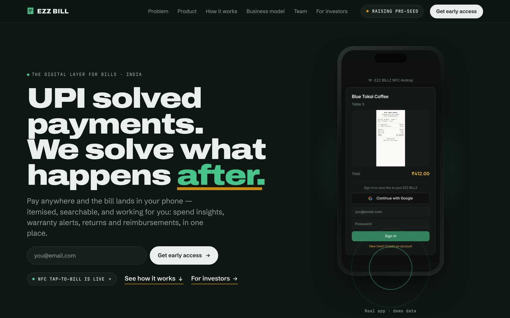

<div align="center">

# 🧾 ezzbill.com

**The marketing and investor site for [EZZ BILL](https://github.com/omkarpatilswork/ez-bill1), the digital layer for bills.**

[](https://ezzbill.com)
[](https://ezzbill.com/#investors)


&nbsp;


</div>

---

## The story the page tells

> **UPI solved payments. We solve what happens after.**

| Section | What it says |
|---|---|
| **Problem** | Every payment leaves a bill behind and almost nobody keeps it, so reimbursements go unclaimed, warranties can't be proven and spending has no context |
| **Product** | *AirDrop for bills.* Tap the table and the bill is on your phone. There's no data entry, and you get Money Leaks, a subscription finder, item-level splits and a warranty vault |
| **How it works** | A step-by-step walkthrough of the NFC tap-to-bill flow, with the guest's view and the staff's view |
| **Business model** | *Merchants pay. Their customers join for free.* Merchant SaaS at ₹499–999 per location per month, consumer premium at ₹49–99 per month |
| **Proof** | *Not a mock-up. A working product.* Nine live features, with real screens from [ezbill.live](https://ezbill.live) |
| **Team and investors** | The founder story, early-access sign-up and a section for investors and incubators |

## Under the hood

- **One static page:** hand-written HTML, CSS and JS with no build step, deployed on Netlify (publish directory is the repo root)
- **Scrollytelling:** GSAP and ScrollTrigger with Lenis smooth scroll, all **self-hosted** in `assets/vendor/` so nothing depends on third-party CDNs
- **Real product screens:** images in `assets/img/` are captured from the live app using demo data, at 1× and 2× sizes
- **Fast by default:** long-lived cache headers for fonts, vendor scripts and images (see `_headers`)
- **Versioned redesigns:** git tags `v7` (investor redesign) and `v8` (portfolio design language: scrollytelling, NFC flow and a proof row)

## Run locally

```bash
git clone https://github.com/omkarpatilswork/ezzbill-site.git
cd ezzbill-site
npx serve .
```

---

Built by **[Omkar Patil](https://github.com/omkarpatilswork)**, founder of EZZ BILL · [omkarpatil.in](https://www.omkarpatil.in)
