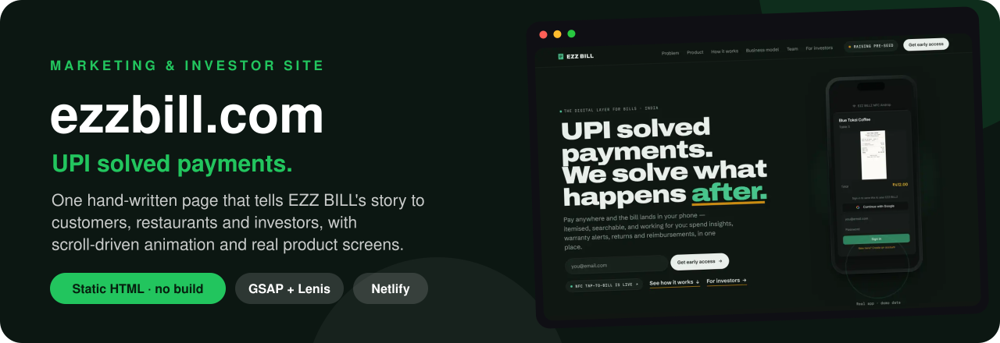
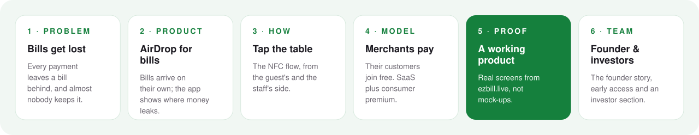
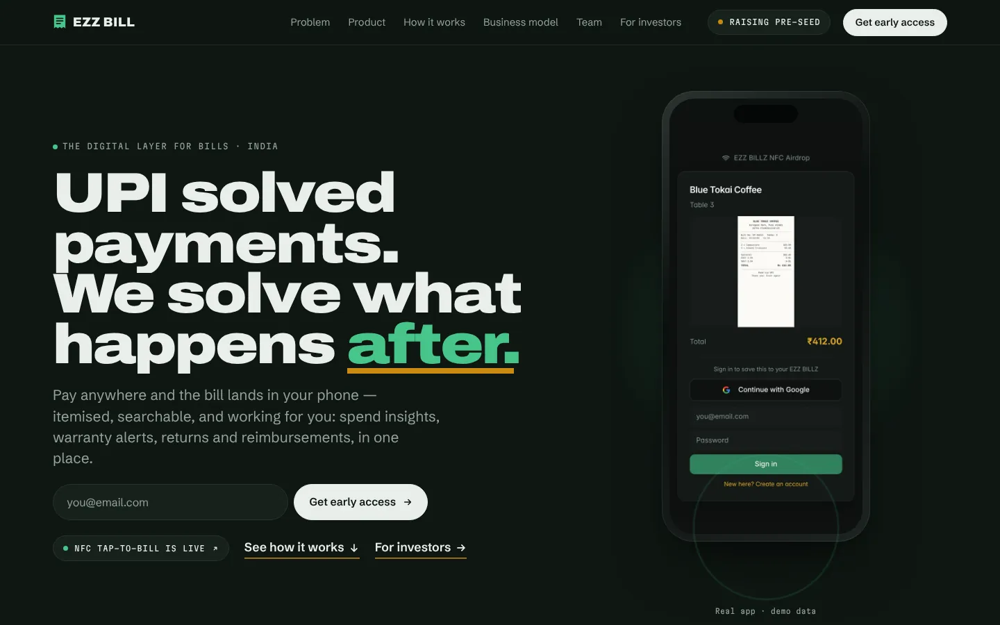
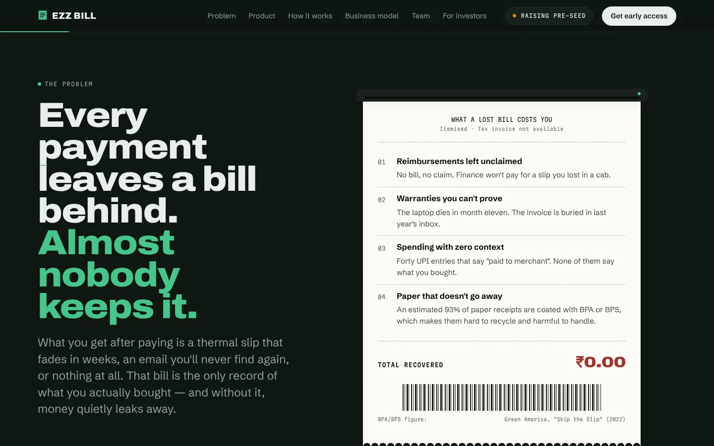
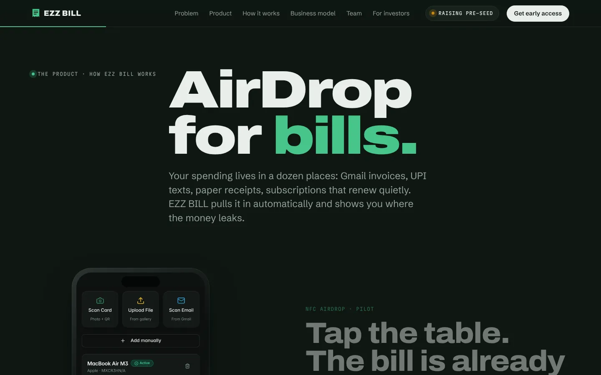
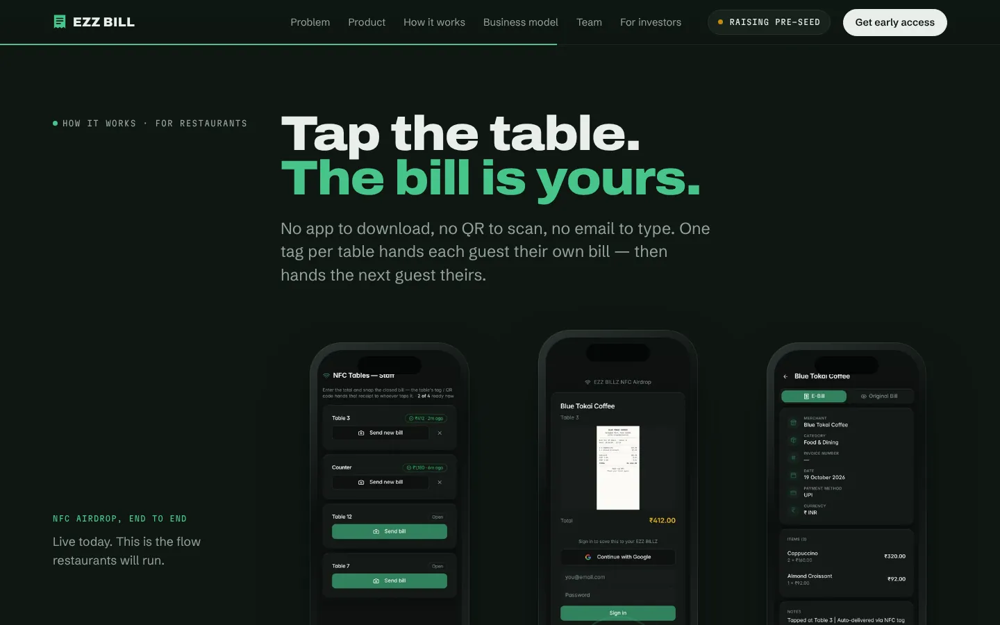
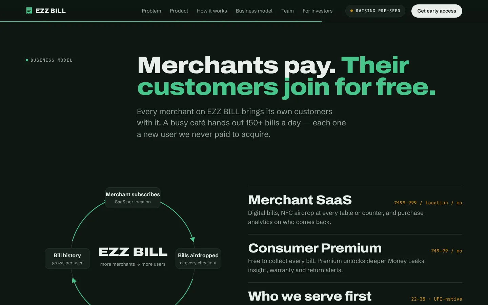
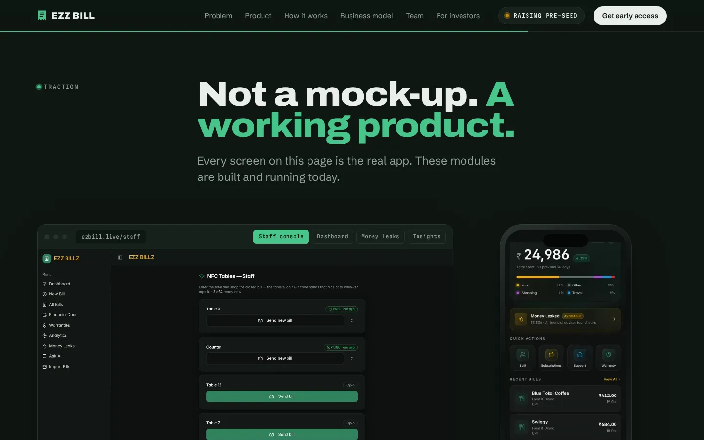
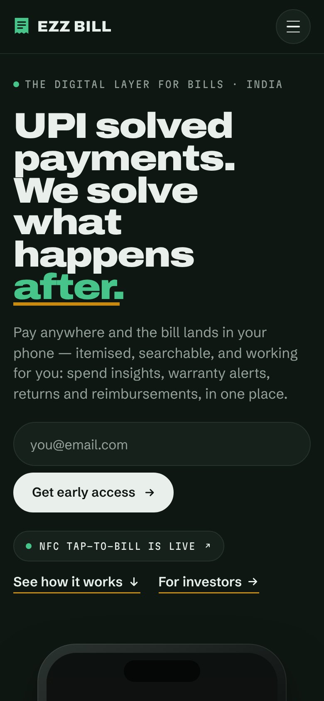

<div align="center">



<br/>

[](https://ezzbill.com)
[](https://ezzbill.com/#investors)
[](https://ezbill.live)


**[What it's for](#01--what-its-for)** ·
**[The story](#02--the-story-the-page-tells)** ·
**[The page](#03--the-page)** ·
**[Under the hood](#04--under-the-hood)** ·
**[Run it](#06--run-it-yourself)**

</div>

---

## 01 · What it's for

This is the public face of **[EZZ BILL](https://github.com/omkarpatilswork/ez-bill1)**, the digital layer for bills. One page has three jobs: explain the product to people who'd use it, show restaurants what NFC table-tap does for them, and give investors and incubators the case for backing it.

> **UPI solved payments. We solve what happens after.**

## 02 · The story the page tells

<div align="center">

</div>

| Section | What it says |
|---|---|
| **Problem** | Every payment leaves a bill behind and almost nobody keeps it, so reimbursements go unclaimed, warranties can't be proven and spending has no context |
| **Product** | *AirDrop for bills.* Tap the table and the bill is on your phone. No data entry, and you get Money Leaks, a subscription finder, item-level splits and a warranty vault |
| **How it works** | A step-by-step walkthrough of the NFC tap-to-bill flow, from the guest's side and the staff's side |
| **One account, every screen** | *At the counter. In the pocket.* The web app in a browser frame (staff console, dashboard, Money Leaks, insights) next to a 40-second phone scroll |
| **Business model** | *Merchants pay. Their customers join for free.* Merchant SaaS at ₹499–999 per location per month, consumer premium at ₹49–99 per month |
| **Proof** | *Not a mock-up. A working product.* Nine live modules and a printed ledger: café pilot in Pune, 50-response survey, 677+ commits, the ExpenseDesk pivot |
| **Team and investors** | The founder story, early-access sign-up and a section for investors and incubators |

## 03 · The page

<table>
<tr>
<td width="50%"><br/><sub><b>Hero.</b> The one-line pitch, an email sign-up and a phone showing a real bill.</sub></td>
<td width="50%"><br/><sub><b>Problem.</b> What a lost bill costs, laid out as a receipt.</sub></td>
</tr>
<tr>
<td width="50%"><br/><sub><b>Product.</b> "AirDrop for bills": where spending lives today, and how it arrives on its own.</sub></td>
<td width="50%"><br/><sub><b>How it works.</b> The table-tap flow with real staff and guest screens.</sub></td>
</tr>
<tr>
<td width="50%"><br/><sub><b>Business model.</b> The merchant flywheel and both revenue streams.</sub></td>
<td width="50%"><br/><sub><b>Proof.</b> Every screen on the page is the real, running app.</sub></td>
</tr>
</table>

<div align="center">

<br/><sub>The same page on a phone.</sub>
</div>

> Screenshots above are from v8. v9 returns to the v7 look (see below); refreshed screenshots to follow.

## 04 · Under the hood

| | |
|---|---|
| **One static page** | Hand-written HTML, CSS and JS, no framework, no libraries and no build step. Netlify publishes the repo root. |
| **Brand: Ink & Paper** | Gloock (headlines), Schibsted Grotesk (text), IBM Plex Mono (wordmark, labels, figures). Ink `#0A110E`, paper `#F2EFE6`, emerald `#3FAF7D`. Fonts are self-hosted in [`assets/fonts/`](assets/fonts). |
| **Motion** | The hero is a 7-second CSS loop: a Blue Tokai Coffee receipt prints, flies into the phone and a "Bill received" toast lands. Tall app screens scroll inside the product phone. All of it respects reduced motion. |
| **Real product screens** | Images in [`assets/screens/`](assets/screens) are captured from the live app with demo data: phone, full-length scrolls and desktop. |
| **Fast by default** | Year-long immutable caching for fonts, a month for screens and video, set in [`_headers`](_headers). |
| **Versioned redesigns** | Git tags `v7` (the investor redesign, source of the Ink & Paper identity), `v8` (portfolio design language experiment) and `v9` (back on Ink & Paper with the new product assets). |

## 05 · Where it stands

|  |  |
|---|---|
| **Status** | Live at [ezzbill.com](https://ezzbill.com). |
| **Product** | The app it describes is live at [ezbill.live](https://ezbill.live) ([repo](https://github.com/omkarpatilswork/ez-bill1)). NFC table-tap is a pilot. |
| **Fundraising** | Raising pre-seed. The investor section links from the top of the page. |

## Adding a demo video

Put the `.mp4` (and ideally a `.webm`) in `assets/video/`, then copy one `<figure class="vcard">` block in the "How it works" section of `index.html` and point its `<source>` tags at the new files.

## 06 · Run it yourself

```bash
git clone https://github.com/omkarpatilswork/ezzbill-site.git
cd ezzbill-site
npx serve .          # or any static file server
```

## Repository map

```
ezzbill-site/
├── index.html          the whole page: markup, styles and scripts
├── _headers            cache rules for Netlify
├── assets/
│   ├── screens/        real app screens: phone, tall scrolls, desktop
│   ├── video/          24s walkthrough, 40s phone scroll
│   ├── fonts/          Gloock, Schibsted Grotesk, IBM Plex Mono
│   └── og.png  favicon.svg
└── docs/               README screenshots and diagram
```

---

<div align="center">
<sub>Built by <a href="https://www.omkarpatil.in">Omkar Patil</a>, founder of EZZ BILL</sub>
</div>
